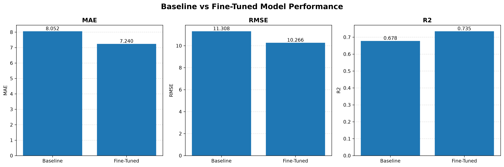
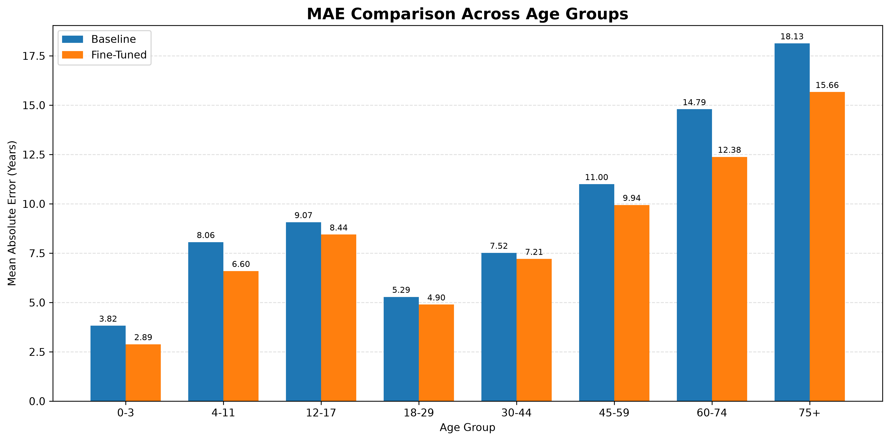
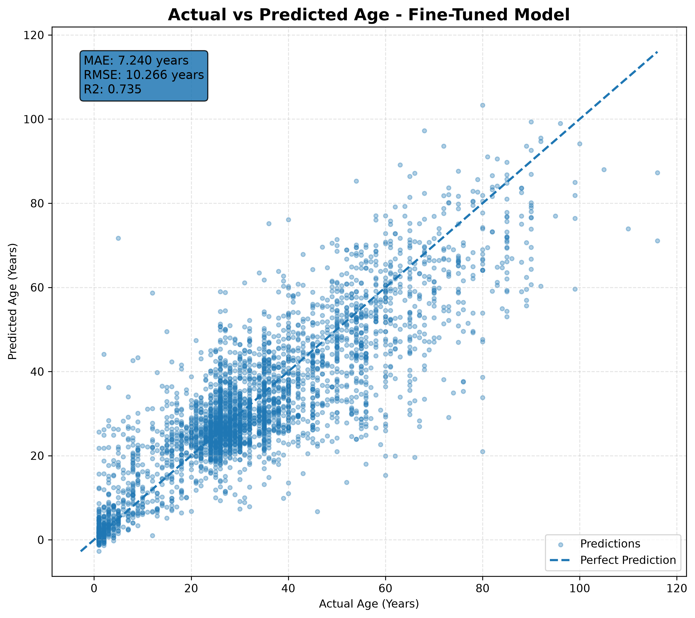

# UTKFace Age Prediction

A Deep Learning project for estimating human age from facial images using Transfer Learning with MobileNetV2.

## Project Overview

This project implements a facial age estimation system using the UTKFace dataset and a pre-trained MobileNetV2 convolutional neural network.

The model treats age estimation as a **regression problem**, predicting a continuous numerical age rather than classifying images into age categories.

The project includes dataset exploration, image validation, data preprocessing, model training, fine-tuning, evaluation, visualization, and single-image age prediction.

## Objectives

- Explore and analyze the UTKFace dataset.
- Validate image files and detect corrupted images.
- Prepare training, validation, and test datasets.
- Apply Transfer Learning using MobileNetV2.
- Train a regression model for age prediction.
- Improve model performance through fine-tuning.
- Evaluate predictions using regression metrics.
- Visualize model performance and prediction errors.

## Dataset

**Dataset:** UTKFace

The project uses the `UTKFace` image directory.

Dataset characteristics:

- Total valid images: 23,708
- Image format: JPEG
- Original image dimensions: 200 × 200
- Model input dimensions: 160 × 160
- Target variable: Age

Age is extracted from the image filenames.

### Age Distribution


### Dataset Splitting

The dataset was divided into three subsets using stratified sampling based on age groups.

| Subset | Number of Images | Percentage |
|---|---:|---:|
| Training | 16,595 | 70% |
| Validation | 3,556 | 15% |
| Testing | 3,557 | 15% |
| **Total** | **23,708** | **100%** |

## Technologies Used

- Python 3.11
- TensorFlow 2.21.0
- Keras
- MobileNetV2
- NumPy
- Pandas
- Matplotlib
- Seaborn
- Scikit-learn
- Pillow

## Model Architecture

The project uses MobileNetV2 as a pre-trained feature extractor with ImageNet weights.

The regression head consists of:

1. MobileNetV2 backbone
2. Global Average Pooling 2D
3. Dropout (0.3)
4. Dense layer (128 neurons, ReLU)
5. Dense output layer (1 neuron, Linear)

### Model Configuration

| Parameter | Value |
|---|---|
| Architecture | MobileNetV2 |
| Input Shape | 160 × 160 × 3 |
| Output | Continuous age value |
| Loss Function | Huber Loss |
| Optimizer | Adam |
| Initial Learning Rate | 0.001 |
| Batch Size | 8 |
| Initial Training Epochs | 15 |

## Training Strategy

### 1. Transfer Learning

The MobileNetV2 backbone was initially frozen.

Only the regression head was trained to learn age-related features.

### 2. Fine-Tuning

After initial training, the model was fine-tuned.

- The backbone was partially unfrozen.
- The last 20 backbone layers were selected for fine-tuning.
- Batch Normalization layers remained frozen.
- Learning rate was reduced to 0.00001.
- Early stopping and model checkpointing were used.

This strategy improved the model's ability to estimate age.

## Evaluation Results

The final evaluation was performed on the held-out test set containing 3,557 images.

### Baseline vs Fine-Tuned Model

| Metric | Baseline Model | Fine-Tuned Model |
|---|---:|---:|
| MAE | 8.05 | **7.24** |
| RMSE | 11.31 | **10.27** |
| R² Score | 0.678 | **0.735** |

The fine-tuned model achieved approximately **10.09% lower MAE** compared with the baseline model.

### Overall Model Comparison



### Age Group Evaluation



The fine-tuned model improved MAE across all eight age groups.

However, age estimation remains more challenging for older individuals, particularly those aged 75 and above.

### Actual vs Predicted Age



## Project Visualizations

Additional visualizations are available in the `reports/` directory:

- Training and validation loss
- Training and validation MAE
- Actual vs predicted age
- MAE by age group
- Baseline vs fine-tuned model comparison

## Project Structure

```text
UTKFace_Age_Prediction/
│
├── dataset/
│   └── UTKFace/
│
├── models/
│   ├── age_prediction_initial.keras
│   ├── age_prediction_pilot.keras
│   ├── best_age_model.keras
│   ├── best_age_model_finetuned.keras
│   ├── training_history.csv
│   ├── fine_tuning_history.csv
│   ├── model_comparison.csv
│   └── ...
│
├── reports/
│   ├── age_distribution.png
│   ├── training_validation_loss.png
│   ├── training_validation_mae.png
│   ├── actual_vs_predicted_age.png
│   ├── mae_per_age_group.png
│   ├── model_metrics_comparison.png
│   ├── age_group_model_comparison.png
│   └── finetuned_actual_vs_predicted.png
│
├── splits/
│   ├── train.csv
│   ├── validation.csv
│   └── test.csv
│
├── weights/
│   └── mobilenet_v2_weights_tf_dim_ordering_tf_kernels_1.0_160_no_top.h5
│
├── 01_explore_dataset.py
├── 02_validate_images.py
├── 03_split_dataset.py
├── 04_prepare_data.py
├── 05_build_model.py
├── 06_pilot_training.py
├── 07_train_model.py
├── 08_evaluate_model.py
├── 09_visualize_results.py
├── 10_predict_age.py
├── 11_fine_tune_model.py
├── 12_evaluate_finetuned_model.py
├── 13_visualize_comparison.py
│
├── requirements.txt
└── README.md
```

## Installation

### 1. Clone the repository

```bash
git clone YOUR_GITHUB_REPOSITORY_URL
cd UTKFace_Age_Prediction
```

### 2. Create a virtual environment

```bash
python -m venv .venv
```

### 3. Activate the environment

Windows PowerShell:

```powershell
.\.venv\Scripts\Activate.ps1
```

### 4. Install dependencies

```bash
python -m pip install --upgrade pip
pip install -r requirements.txt
```

### 5. Prepare the dataset

Download the UTKFace dataset and place the images in:

```text
dataset/UTKFace/
```

### 6. Run the project

Execute the scripts in numerical order, starting with dataset exploration:

```bash
python 01_explore_dataset.py
python 02_validate_images.py
python 03_split_dataset.py
python 04_prepare_data.py
python 05_build_model.py
python 06_pilot_training.py
python 07_train_model.py
python 08_evaluate_model.py
python 09_visualize_results.py
python 11_fine_tune_model.py
python 12_evaluate_finetuned_model.py
python 13_visualize_comparison.py
```

For single-image prediction, place an image named `test_face.jpg` in the project root and run:

```bash
python 10_predict_age.py
```

**Note:** Training and evaluation scripts require the dataset and previously generated model files. Run them in the appropriate order.

## Limitations

- Age estimation is less accurate for older age groups.
- Facial appearance does not always correspond closely to chronological age.
- Model performance depends on dataset quality and demographic representation.
- The model predicts an estimate and should not be treated as an exact age measurement.

## Future Improvements

- Experiment with alternative CNN architectures.
- Improve performance on underrepresented age groups.
- Apply additional data augmentation techniques.
- Explore advanced loss functions for age regression.
- Evaluate model robustness on external datasets.

## Disclaimer

This project is intended for educational and research purposes only.

Age predictions are approximate and should not be used for identity verification or other high-stakes decisions.

## Author

**Your Name**

Deep Learning | Computer Vision | Python
